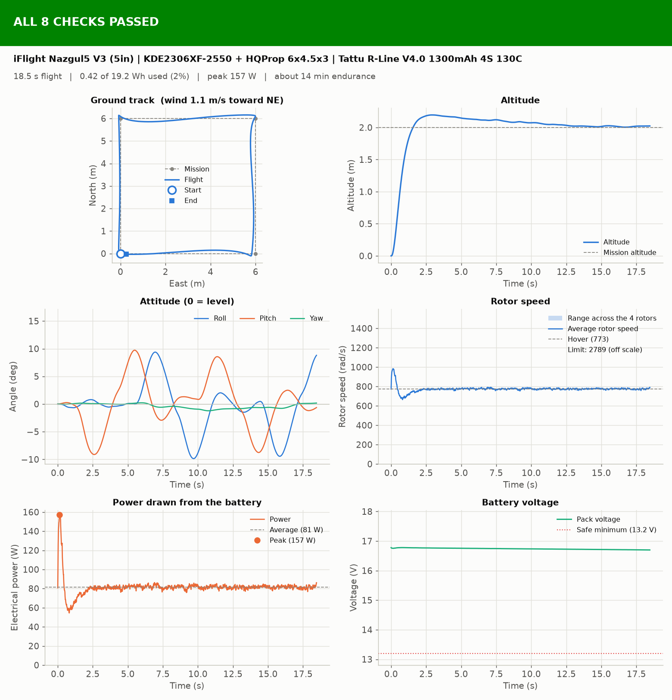
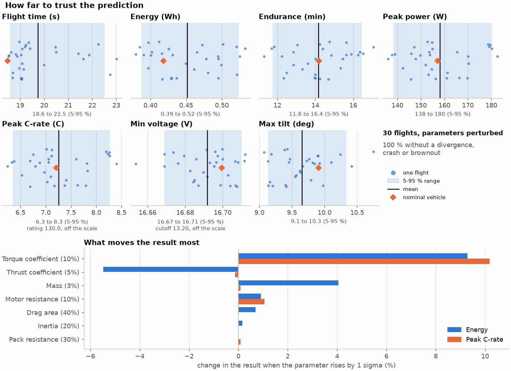
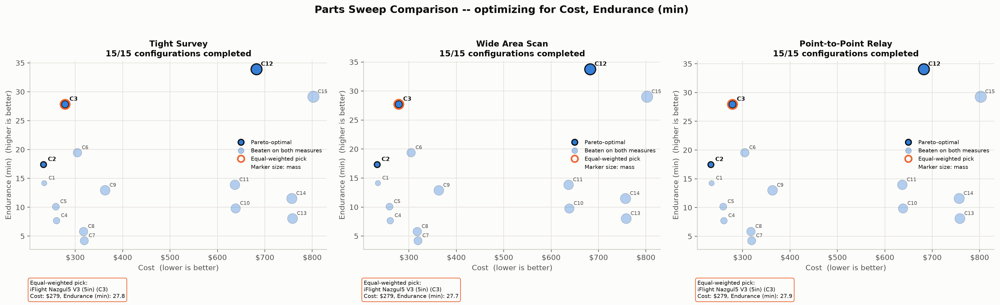

# Aeronost

A Python simulator of six-degree-of-freedom quadrotor flight, built to be checked against real flight logs. It models a rigid body with quaternion attitude, a motor and battery model, control allocation and a geometric position-hold controller, and it runs from a flight file, a command line or a desktop window.

> The source code is proprietary and is not published here. This page shows what the software does and what it produces. Access to the source code can be requested from the author.

**Status:** version 4.0.1 · 62 tagged releases · 662 automated tests · Python 3.11 and later. The model has been tested against closed-form solutions and against the simulator's own flights. It has **not yet been compared with a real flight log**; a group of three is building a quadrotor to record the first ones.

## What it does

- **Rigid-body dynamics.** A 13-state nonlinear model (position, body velocity, quaternion attitude, body rates) with Newton–Euler equations and fourth-order Runge–Kutta integration. Free fall, drag-limited terminal velocity, torque-free precession and the integrator's order of convergence are checked against closed-form solutions.
- **Control.** A geometric attitude controller with cascaded position hold and a mixer that allocates thrust and moments to four rotors. The inner rate loop can be replaced with a PID loop.
- **Electrical and aerodynamic models.** Motor current, ESC behavior, battery voltage sag and capacity, ground effect, wind and turbulence, sensor noise, and optional rotor aerodynamics (translational lift and in-plane rotor drag). Every optional model is off by default and takes numbers from a datasheet or a measurement.
- **Validation tooling.** `aeronost compare` aligns a recorded flight with the simulation in time, replays it through the model, and reports the error by channel against limits set before the flight. A prediction is stored with a SHA-256 hash of its settings, so a change made after the flight is detected.
- **Uncertainty.** Monte Carlo runs over seven estimated vehicle parameters show the spread of each result and which parameter moves it most.
- **Parts sweep.** Every compatible combination of catalog frames, motors, propellers and batteries is flown on three missions, and the Pareto-optimal configurations are reported.

## A flight

A square mission at 2 m, flown by the geometric controller with wind. Each run reports a pass/fail check list; this one passed all eight.

## How far to trust a prediction

Thirty flights with the estimated vehicle parameters perturbed (mass, inertia, drag area, thrust and torque coefficients, motor and pack resistance). The right-hand chart ranks the parameters by how much they move the result.

## Choosing parts

Fifteen compatible configurations flown on three missions, optimized for cost and endurance. Three configurations are Pareto-optimal on each mission. Endurance here is a model estimate and is optimistic.

## Testing

The 662 tests cover the dynamics, controller, mixer, motor and battery models, log reading, time alignment, the prediction check and the window. Where a closed-form solution exists, the test compares against it. Changes to the code are also checked by mutation: a deliberate fault is inserted and the tests must catch it.

## About

Built by Joel Prescott, aerospace engineering student at Mississippi State University. [LinkedIn](https://www.linkedin.com/in/joel-prescott-ab3447309/)

Copyright (c) 2026 Joel Prescott. All rights reserved.
